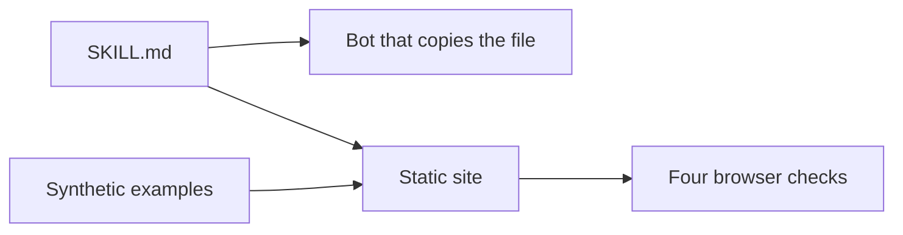

# grok-bot-open-skills

https://eflores1122.github.io/grok-bot-open-skills/

Procedures for a Grok bot. Each skill is a `SKILL.md` file: YAML frontmatter (`name`, `description`) and a markdown checklist. Copy the file into your bot. The bot follows it when the task matches the description.

This pack covers a remote job search run from Mexico, CV wording, a public GitHub profile, and a small open-data pipeline. It is an independent project by Edgar Flores. It is not affiliated with Cursor, xAI, or the Grok product, and it is not an official skill library.

Examples in this repository are synthetic. The companies, candidates, pay figures, and datasets are fictional. They are not a record of a real job search.

## Problem

A bot that helps with a job search can invent a career, collect private contact details, or send an application the person has not approved. These procedures tell it to draft from public text and to stop before anything is sent.

## Architecture



There is no model call and no server. The site renders the skill files. The checks run in the browser. The bot, if you use one, reads `SKILL.md` only when you copy that file in.

## Who it is for

For someone who runs a bot and wants to copy a whole procedure into `bot/skills/`. It is not a job board, and it does not send applications.

## Put a skill in a bot

Copy the skill folder unchanged:

```text
skills/remote-job-hunt-mx/SKILL.md
  →  <your-bot>/bot/skills/remote-job-hunt-mx/SKILL.md
```

Do the same for the other folders. The `name` in the frontmatter matches the folder name. If your bot loads skills from another directory, keep the file intact and point the bot at it. Keep one copy, in the skills folder, rather than pasting the whole procedure into the system prompt.

`bot-template.md` walks through turning the job-hunt skill into a teammate that drafts and stops before anything is sent.

## Skills

| Folder | Use it when |
| --- | --- |
| `skills/remote-job-hunt-mx` | You are searching remote roles you can do from Mexico and you want a score, a draft, and a stop before you apply. |
| `skills/ats-cv-tailor` | You have a posting and a CV, and you want bullets rewritten for an ATS without invented history. |
| `skills/portfolio-github-polish` | You want a public GitHub profile and READMEs a stranger can judge in a few minutes. |
| `skills/open-data-mx-pipeline` | You want a small pipeline over a Mexican public dataset, with the license and the raw file kept. |

Each folder has a `README.md` for people, with the same five sections: who it is for, how to use it, a fictional example, what it does not do, and the license. `SKILL.md` is the file the bot follows.

`examples/synthetic-posting.md` is a fake posting and a bullet rewrite. The company and the candidate are not real. Use it to see the output shape, or to test a bot.

`examples/synthetic-constraints.md` is a fake set of constraints for that posting. The scorer tests and the site button that loads the test case both read it. The person is not real.

## Rules for use

The skills repeat these. They are here so you see them before you copy anything.

- **Public sources only.** Career pages, job boards, and open-data catalogs you can open without a bypass. No scraping of private profiles, no logged-in portals, no contact lists, no email harvesting.
- **You confirm every application.** The bot drafts the text and a score. You send the application yourself, on the employer's site. The bot does not mark anything sent until you say you sent it.
- **Salary stays honest.** Quote the pay line as the posting wrote it. If there is no number, say unknown. Do not invent a band, do not raise your pay to match a guess, and do not cut your real floor to look cheaper. Take-home depends on your régimen; this pack does not calculate ISR.
- **History stays honest.** No fake employers, dates, degrees, tools, stars, or metrics.

## Run the site

```bash
npm ci
npm test
npm run dev
npm run build
```

`npm test` runs the checks. `npm run dev` serves the site locally. `npm run build` writes `dist/` for GitHub Pages. The published site is GitHub Pages from `.github/workflows/pages.yml`. There is no other server.

## What it does and what it leaves out

The site renders each SKILL.md, copies the file, and runs four checks in the browser: keyword use or drop, the six posting scores, a README section check, and an open-data source block.

It does not submit an application, invent a salary, fetch an exchange rate, compute ISR or IMSS, or download a dataset. A passing score is not a decision to apply. Text you type stays in the browser. The examples are synthetic, so a check that passes on them only shows the shape of the output.

## Stack

`vite` builds the static site. `@fontsource/atkinson-hyperlegible` and `@fontsource/ibm-plex-mono` supply the fonts. Text is set in Atkinson Hyperlegible so similar letters stay distinct while you read and copy a procedure. Skill names and figures use IBM Plex Mono. Node 22 runs the tests. There is no backend.

## Tests

`npm test` runs the Node test runner. The checks cover skill frontmatter, the synthetic posting and constraints, the six scores, README section order, and that the Spanish and English interface copy share the same keys. They also reject an email address, a CURP value, a phone number, or a token-shaped secret in the tree.

`npm run lint` checks that every JavaScript file parses.

Pull requests run both in `.github/workflows/ci.yml`. The Pages workflow runs the tests again before it publishes `main`.

## Layout

```text
.github/workflows/ci.yml
.github/workflows/pages.yml
bot-template.md
CONTRIBUTING.md
LICENSE
examples/synthetic-posting.md
examples/synthetic-constraints.md
package.json
scripts/lint.js
site/
skills/<name>/README.md
skills/<name>/SKILL.md
src/lib/
test/
```

## License

MIT. Copyright (c) 2026 Edgar Flores. See `LICENSE`.

## Nota en español

Estos archivos son procedimientos para un bot. No son un producto oficial de Cursor, xAI ni Grok. El sitio https://eflores1122.github.io/grok-bot-open-skills/ muestra cada SKILL.md, lo copia y corre en el navegador el comparador de palabras, la calificación de 0 y 2, la revisión de un README y el bloque de fuente. Cada carpeta en `skills/` tiene un README con las mismas cinco secciones y un ejemplo ficticio. Copia `SKILL.md` a `bot/skills/` en tu bot. El bot redacta; tú confirmas cada postulación antes de enviarla. No inventes sueldos, puestos ni años de experiencia. No pongas teléfono, correo, domicilio, CURP ni datos de un empleador real. No saques datos de portales privados, perfiles cerrados ni listas de correos.
